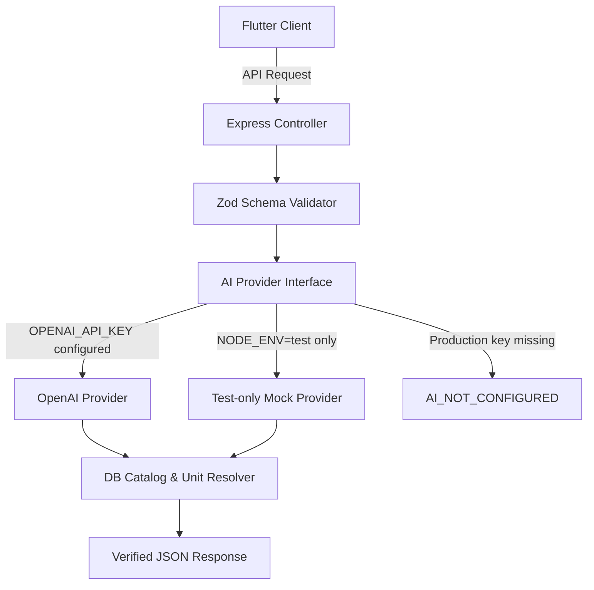

# Cal - AI Features Specification & Safety Guidelines (docs/AI_FEATURES.md)

This document standardizes the specifications, schemas, uncertainty handling, safety bounds, and privacy limits for all AI-powered features in Cal.

---

## 1. Core Rule: Code Calculates Numbers, Not LLM
- AI models are used strictly for **entity extraction**, **text comprehension**, **vision recognition**, and **contextual synthesis**.
- All nutritional values (calories, grams, deficit/surplus, percentages) are calculated in deterministic backend code from verified food database records, never generated freely by language models.

---

## 2. Feature Specifications

### 2.1 Food Vision Estimation (F02)
- **Input:** Base64 encoded JPEG/PNG image (compressed on client, max 4MB, EXIF/GPS stripped).
- **Output JSON Schema:**
```json
{
  "$schema": "http://json-schema.org/draft-07/schema#",
  "type": "object",
  "properties": {
    "is_food": { "type": "boolean" },
    "non_food_reason": { "type": "string" },
    "detected_items": {
      "type": "array",
      "items": {
        "type": "object",
        "properties": {
          "label": { "type": "string" },
          "estimated_portion_description": { "type": "string" },
          "estimated_grams": { "type": "number", "minimum": 1, "maximum": 2000 },
          "confidence_score": { "type": "number", "minimum": 0, "maximum": 1 }
        },
        "required": ["label", "estimated_grams", "confidence_score"]
      }
    }
  },
  "required": ["is_food", "detected_items"]
}
```
- **Uncertainty & Non-Food Handling:**
  - If `is_food == false` or `confidence_score < 0.4`: prompt user that items could not be recognized reliably and provide instant manual search fallback.
  - Every detected item is presented in a draft review screen with the explicit label **"Estimasi AI"**.
  - The user must review, optionally edit identity/quantity, and explicitly confirm before any data is saved to `meal_log_items`.

### 2.2 Natural Language Food Logging (F04)
- **Input:** Natural Indonesian or English sentence (e.g., *"nasi 2 centong, dada ayam 150 gram, dan 1 potong tempe goreng"*).
- **Processing:**
  1. LLM extracts entities: `[{ food_name: "nasi", quantity: 2, raw_unit: "centong" }, ...]`.
  2. Code normalizes local household units to standard grams via lookup table (`centong` -> 100g, `potong tempe` -> 50g, `sdm` -> 15g, `butir` -> 50g).
  3. Code searches verified `food_items` database and computes exact macros based on normalized grams.
- **Output:** Structured candidate list for confirmation.

### 2.3 AI Nutrition Coach (F08)
- **Scope & Role:** Act as an encouraging, evidence-based fitness companion that explains consumption patterns, helps plan meals around remaining macro budgets, and suggests healthy Indonesian culinary adjustments.
- **Data Access:** Only reads current user's authenticated targets, today's meal logs, and 7-day averages retrieved via server-side authorization. Zero access to other users' data.
- **Safety Bounds (Strict):**
  - **No Medical Claims:** Explicit disclaimer: *"Cal AI Coach memberikan panduan gaya hidup sehat dan bukan pengganti saran medis profesional."*
  - **Eating Disorder Prevention:** If input asks for starvation diet (< 1000 kcal), purging, or extreme fasting, AI refuses and provides supportive guidance toward safe minimum boundaries (1200 kcal female, 1500 kcal male).
  - **No Hallucinated Data:** Only answers based on actual logged numbers from DB query tools.

### 2.4 AI Workout Generator (F15)
- **Scope:** Generates exercise splits based on user schedule (e.g., 3-day full body, PPL) and available equipment.
- **Validation:** Matches proposed movements to verified `exercises` catalog.

---

## 3. Provider Abstraction Architecture

Production provider currently implemented: **OpenAI**. `MockAIProvider` is selected only in automated tests; production with no `OPENAI_API_KEY` returns an explicit `AI_NOT_CONFIGURED` error. Provider failures are not replaced with simulated results.


