# Cal - Database Schema & ERD (docs/ERD.md)

Relational schema designed for PostgreSQL 18 with UTC timestamps and user timezone storage.

```mermaid
erDiagram
    users ||--o{ user_nutrition_targets : has
    users ||--o{ meal_logs : logs
    users ||--o{ water_logs : logs
    users ||--o{ body_measurements : records
    users ||--o{ workout_sessions : conducts
    users ||--o{ workout_routines : creates
    users ||--o{ personal_records : holds
    users ||--o| user_xp : has
    users ||--o{ xp_audit_logs : earns
    users ||--o{ user_achievements : unlocks
    users ||--o{ group_members : participates
    users ||--o{ community_posts : authors
    users ||--o{ refresh_tokens : owns

    meal_logs ||--o{ meal_log_items : contains
    food_items ||--o{ meal_log_items : references

    workout_routines ||--o{ workout_routine_exercises : includes
    exercises ||--o{ workout_routine_exercises : referenced_in
    workout_sessions ||--o{ workout_sets : records
    exercises ||--o{ workout_sets : performed_in
    exercises ||--o{ personal_records : records_for

    groups ||--o{ group_members : has
    groups ||--o{ community_posts : contains
    community_posts ||--o{ community_reactions : receives
    community_posts ||--o{ community_comments : receives

    achievements ||--o{ user_achievements : awarded
    challenges ||--o{ user_challenges : tracked
    users ||--o{ user_challenges : attempts
```

---

## Key Table Definitions

### 1. `users`
- `id` UUID PRIMARY KEY DEFAULT gen_random_uuid()
- `email` VARCHAR(255) UNIQUE NOT NULL
- `password_hash` VARCHAR(255) NOT NULL
- `name` VARCHAR(100) NOT NULL
- `age` INTEGER CHECK (age >= 18)
- `gender` VARCHAR(20) -- 'male', 'female', 'other'
- `height_cm` NUMERIC(5,2)
- `weight_kg` NUMERIC(5,2)
- `activity_level` VARCHAR(30) -- 'sedentary', 'light', 'moderate', 'heavy', 'very_heavy'
- `goal` VARCHAR(30) -- 'lose', 'maintain', 'gain'
- `timezone` VARCHAR(50) DEFAULT 'Asia/Jakarta'
- `created_at` TIMESTAMPTZ DEFAULT NOW()
- `updated_at` TIMESTAMPTZ DEFAULT NOW()

### 2. `user_nutrition_targets`
- `user_id` UUID PRIMARY KEY REFERENCES users(id) ON DELETE CASCADE
- `target_calories` INTEGER NOT NULL
- `target_protein_g` NUMERIC(6,2) NOT NULL
- `target_carbs_g` NUMERIC(6,2) NOT NULL
- `target_fat_g` NUMERIC(6,2) NOT NULL
- `target_water_ml` INTEGER NOT NULL DEFAULT 2000
- `is_manual` BOOLEAN DEFAULT FALSE
- `updated_at` TIMESTAMPTZ DEFAULT NOW()

### 3. `food_items`
- `id` UUID PRIMARY KEY DEFAULT gen_random_uuid()
- `name` VARCHAR(255) NOT NULL
- `name_id` VARCHAR(255)
- `brand` VARCHAR(150)
- `barcode` VARCHAR(64) UNIQUE
- `serving_size` NUMERIC(8,2) NOT NULL DEFAULT 100
- `serving_unit` VARCHAR(50) NOT NULL DEFAULT 'gram'
- `calories` NUMERIC(8,2) NOT NULL
- `protein_g` NUMERIC(6,2) NOT NULL DEFAULT 0
- `carbs_g` NUMERIC(6,2) NOT NULL DEFAULT 0
- `fat_g` NUMERIC(6,2) NOT NULL DEFAULT 0
- `fiber_g` NUMERIC(6,2) DEFAULT 0
- `source` VARCHAR(50) NOT NULL -- 'usda', 'tkpi', 'open_food_facts', 'custom_user', 'ai_estimate'
- `license` VARCHAR(100)
- `is_verified` BOOLEAN DEFAULT FALSE
- `created_by` UUID REFERENCES users(id) ON DELETE SET NULL
- `created_at` TIMESTAMPTZ DEFAULT NOW()

### 4. `meal_logs` & `meal_log_items`
- `meal_logs`: `id`, `user_id`, `log_date` (DATE), `meal_type` (breakfast/lunch/dinner/snack), `created_at`
- `meal_log_items`: `id`, `meal_log_id` REFERENCES meal_logs(id) ON DELETE CASCADE, `food_item_id` REFERENCES food_items(id), `food_name`, `serving_qty`, `serving_unit`, `calories`, `protein_g`, `carbs_g`, `fat_g`, `source`, `confidence_score`, `snapshot_data` JSONB

### 5. `workout_sessions` & `workout_sets`
- `workout_sessions`: `id`, `user_id`, `routine_id`, `title`, `started_at`, `completed_at`, `status` ('in_progress', 'completed', 'cancelled'), `duration_seconds`, `total_volume_kg`, `notes`
- `workout_sets`: `id`, `session_id` REFERENCES workout_sessions(id) ON DELETE CASCADE, `exercise_id` REFERENCES exercises(id), `set_number`, `reps`, `weight_kg`, `rpe`, `is_personal_record`

### 6. `xp_audit_logs` & `user_xp`
- `user_xp`: `user_id` PRIMARY KEY, `total_xp` INT DEFAULT 0, `current_level` INT DEFAULT 1, `current_streak_days` INT DEFAULT 0, `last_activity_date` DATE
- `xp_audit_logs`: `id`, `user_id`, `event_code`, `xp_amount`, `idempotency_key` VARCHAR(255) UNIQUE NOT NULL, `metadata` JSONB, `created_at`
